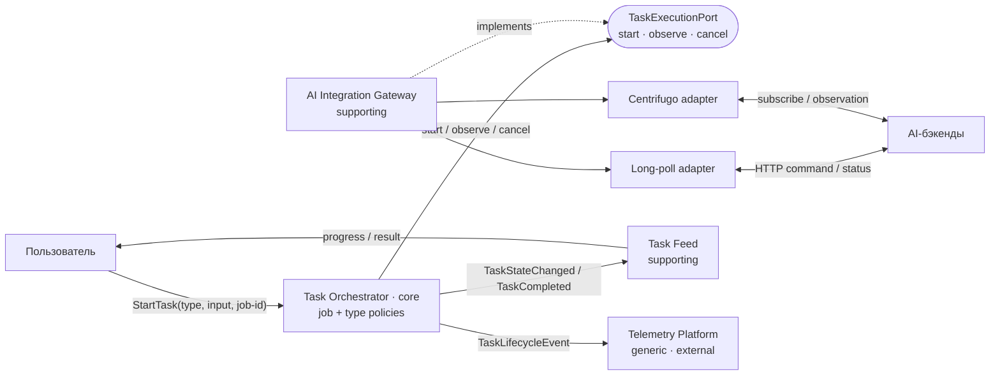

# 04 · Декомпозиция на сервисы

## Предметная область и способ декомпозиции

**Домен:** надёжное выполнение долгих асинхронных AI-задач в Selene SPA. Пользователь
запускает генерацию, наблюдает прогресс и получает ровно один результат, даже если
транспорт временно недоступен или вкладка была перезагружена.

Декомпозицию определяют три драйвера из README: **D1** — убрать дублирование жизненного
цикла, **D2** — гарантировать завершение без потерь и дублей, **D3** — менять транспорт
независимо от правил задачи.

Основной способ декомпозиции — **by Subdomain**: границы проводятся по различающимся
моделям и ответственности. Внутри core-поддомена возможности сгруппированы
**by Business Capability**. Транспорт, база данных и WebSocket сами по себе не являются
сервисами: это технические детали за портами.

**Единый язык:** *задача (job)* — единица асинхронной работы; *тип задачи* — её контракт
и политики; *наблюдение* — полученное от AI-бэкенда состояние; *терминал* — `done`,
`failed`, `timeout` или `canceled`; *результат* — полезная нагрузка завершённой задачи;
*job-id* — ключ идемпотентности.

## Бизнес-возможности и поддомены

| Возможность | Тип поддомена | Драйвер и обоснование |
|---|---|---|
| Запустить AI-задачу с уникальным `job-id` | **core** | D1: начало единого жизненного цикла |
| Управлять переходами, retry, timeout и cancel | **core** | D2: правила надёжного завершения |
| Восстановить незавершённую задачу после reload | **core** | D2: задача не теряется вместе с вкладкой |
| Дедуплицировать повторы и принять один результат | **core** | D2: корректность при at-least-once |
| Описать тип задачи, схему результата и политики | **supporting** | D1: новый тип подключается конфигом |
| Получать состояние через long-poll или WebSocket | **supporting** | D3: внешние протоколы нормализуются |
| Показать пользователю прогресс и итог | **supporting** | Проекция доменного состояния для пользователя |
| Собирать метрики, логи и трассировки | **generic** | Готовая инфраструктурная возможность |

## Границы и владение данными

Ниже показаны **логические сервисы (границы ответственности / bounded contexts)**, а не
обещание немедленно развернуть четыре процесса. В текущей реализации они остаются
модулями SPA. Физически отделять границу стоит, только если ей понадобятся независимое
масштабирование, релизный цикл или отдельный владелец. При таком выделении каждый сервис
получает своё хранилище; общей базы «на всех» нет.

| Сервис / поддомен | Ответственность одной фразой | Владеет данными |
|---|---|---|
| **Task Orchestrator** / core | Доводит каждую принятую задачу до одного терминального состояния | `job`, история переходов, deadline, retry, `job-id`, принятый результат; определения типов и версии политик |
| **AI Integration Gateway** / supporting | Преобразует протокол конкретного AI-бэкенда в единые наблюдения | привязка `job-id ↔ upstream-id`, endpoint/channel, poll cursor или subscription, техническое состояние соединения |
| **Task Feed** / supporting | Показывает пользователю прогресс и терминальный результат его задач | read-model пользователя, порядок карточек, отметки `seen`; не владеет истинным состоянием `job` |
| **Telemetry Platform** / generic, внешняя | Принимает технические события и строит метрики выполнения | логи, spans, агрегаты и retention; не меняет состояние задач |

`localStorage` — текущий адаптер хранилища **Task Orchestrator**, а long-poll и
Centrifugo — адаптеры **AI Integration Gateway**. Они не получают самостоятельную
доменную ответственность. Определения типов остаются конфигурацией Orchestrator:
выносить ради них отдельный каталог пока нет независимого сценария изменения.

## Проверка cohesion / coupling

| Сервис | Почему высокая сплочённость | Допустимая связанность |
|---|---|---|
| Task Orchestrator | Все правила и конфигурации служат одной цели: провести задачу по жизненному циклу до терминала | Вызывает execution-port; публикует события задачи |
| AI Integration Gateway | Все изменения вызваны протоколами внешних AI-бэкендов | Реализует execution-port и возвращает нормализованное `TaskObservation`, не записывая `job` |
| Task Feed | Все правила относятся к пользовательской проекции задач | Асинхронно потребляет `TaskStateChanged` / `TaskCompleted`; временная задержка проекции допустима |
| Telemetry Platform | Все данные нужны только для диагностики и измерений | Асинхронно получает копии событий; отказ telemetry не блокирует выполнение |

**Риск высокой связанности.** Gateway или Task Feed могут начать напрямую менять строку
`job` в хранилище Orchestrator: тогда схема общей базы станет скрытым контрактом, а
изменение state machine потребует согласованного релиза нескольких сервисов. Риск
снимается единственным владельцем данных:

- Gateway передаёт наблюдение только через контракт
  `TaskExecutionPort.observe(jobId) -> TaskObservation`;
- Orchestrator единолично проверяет допустимость перехода и сохраняет состояние;
- наружу он публикует версионированные события `TaskStateChanged` и `TaskCompleted`;
- Task Feed и Telemetry строят собственные модели из событий, без чтения таблиц
  Orchestrator.

Итоговая оценка — **high cohesion / low coupling**: правила жизненного цикла собраны в
core, изменения внешних протоколов изолированы в gateway, UI и telemetry зависят только
от событий. Компромисс — eventual consistency пользовательской проекции.

Для сравнения, исходный вариант с двумя стейт-машинами имеет **низкую сплочённость**
(каждый модуль одновременно управляет UI, polling, retry и persistence) и **высокую
связанность** (оба знают формат общего `localStorage` и детали backend API). Выделять же
каждый порт или конфиг в отдельный сервис было бы обратной ошибкой: границы стали бы
слишком мелкими, а сетевой coupling — выше.

## Карта сервисов и DIP

**DIP:** core-сервис `Task Orchestrator` зависит от абстракции
`TaskExecutionPort`, определённой на его границе, а не от long-poll, Centrifugo или
конкретного gateway. Инфраструктурные адаптеры реализуют этот контракт. Поэтому замена
polling на push меняет адаптер, но не state machine и не бизнес-правила core-поддомена.

## Вывод

Границы проведены по причинам изменения, а не по техническим слоям. Core остаётся один:
надёжный жизненный цикл задачи вместе с конфигурацией его типов. Supporting-поддомены
интегрируют внешние протоколы и строят пользовательскую проекцию; generic-наблюдаемость
остаётся внешней платформой. Это минимальная декомпозиция: сначала модули, а отдельные
deployable-сервисы — только при подтверждённой операционной причине.
