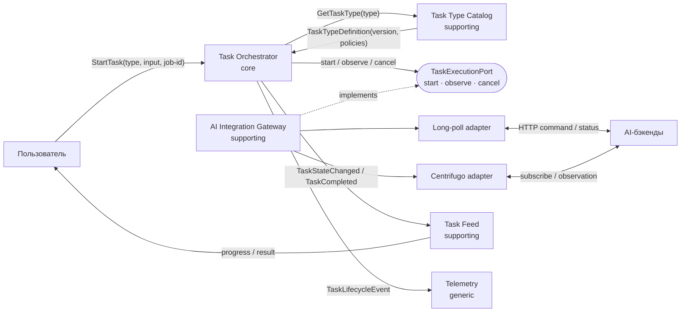

# 04 · Декомпозиция на сервисы

## Предметная область и способ декомпозиции

**Домен:** надёжное выполнение долгих асинхронных AI-задач в Selene SPA. Пользователь
запускает генерацию, наблюдает прогресс и получает ровно один результат, даже если
транспорт временно недоступен или вкладка была перезагружена.

Основной способ декомпозиции — **by Subdomain**: границы проводятся по различающимся
моделям и ответственности. Внутри core-поддомена возможности сгруппированы
**by Business Capability**. Транспорт, база данных и WebSocket сами по себе не являются
сервисами: это технические детали за портами.

**Единый язык:** *задача (job)* — единица асинхронной работы; *тип задачи* — её контракт
и политики; *наблюдение* — полученное от AI-бэкенда состояние; *терминал* — `done`,
`failed`, `timeout` или `canceled`; *результат* — полезная нагрузка завершённой задачи;
*job-id* — ключ идемпотентности.

## Бизнес-возможности и поддомены

| Возможность | Тип поддомена | Почему |
|---|---|---|
| Запустить AI-задачу с уникальным `job-id` | **core** | Начало единого жизненного цикла и основа ценности платформы |
| Управлять переходами, retry, timeout и cancel | **core** | Здесь сосредоточены правила надёжного завершения |
| Восстановить незавершённую задачу после reload | **core** | Отличает платформу от обычного вызова API |
| Дедуплицировать повторы и принять один результат | **core** | Обеспечивает корректность при at-least-once |
| Описать тип задачи, схему результата и политики | **supporting** | Поддерживает добавление новых генераторов, но не выполняет задачу |
| Получать наблюдения через long-poll или WebSocket | **supporting** | Интегрирует разные AI-бэкенды с единой моделью задачи |
| Показать пользователю прогресс и итог | **supporting** | Проецирует состояние задачи в пользовательское представление |
| Собирать метрики, логи и трассировки | **generic** | Стандартная инфраструктурная возможность, не уникальная для домена |

## Границы и владение данными

Логические сервисы могут сначала поставляться как модули одного SPA. Границы ниже
остаются теми же при выносе оркестрации на сервер: у каждого сервиса своё хранилище,
общей базы «на всех» нет.

| Сервис / поддомен | Ответственность одной фразой | Владеет данными |
|---|---|---|
| **Task Orchestrator** / core | Доводит каждую принятую задачу до одного терминального состояния | `job`, текущее состояние, история переходов, deadline, retry, `job-id`, ссылка/копия принятого результата |
| **Task Type Catalog** / supporting | Публикует версионированные определения типов задач | тип, версия схемы команды и результата, timeout/backoff policy, имя требуемого execution-контракта |
| **AI Integration Gateway** / supporting | Преобразует протокол конкретного AI-бэкенда в единые наблюдения | привязка `job-id ↔ upstream-id`, endpoint/channel, poll cursor или subscription, техническое состояние соединения |
| **Task Feed** / supporting | Показывает пользователю прогресс и терминальный результат его задач | read-model пользователя, порядок карточек, отметки `seen`; не владеет истинным состоянием `job` |
| **Telemetry** / generic | Принимает технические события и строит метрики выполнения | логи, spans, агрегаты и retention; не меняет состояние задач |

`localStorage` — текущий адаптер хранилища **Task Orchestrator**, а long-poll и
Centrifugo — адаптеры **AI Integration Gateway**. Они не получают самостоятельную
доменную ответственность.

## Проверка cohesion / coupling

| Сервис | Почему высокая сплочённость | Допустимая связанность |
|---|---|---|
| Task Orchestrator | Все правила меняются по одной причине: изменение жизненного цикла и гарантий выполнения задачи | Синхронно читает версию типа при старте; вызывает execution-port; публикует события задачи |
| Task Type Catalog | Все данные относятся только к описанию и версионированию типов | Контракт `TaskTypeDefinition`; активная задача сохраняет принятую версию и не зависит от будущих правок каталога |
| AI Integration Gateway | Все изменения вызваны протоколами внешних AI-бэкендов | Реализует execution-port и возвращает нормализованное `TaskObservation`, не записывая `job` |
| Task Feed | Все правила относятся к пользовательской проекции задач | Асинхронно потребляет `TaskStateChanged` / `TaskCompleted`; временная задержка проекции допустима |
| Telemetry | Все данные нужны только для диагностики и измерений | Асинхронно получает копии событий; отказ telemetry не блокирует выполнение |

**Риск высокой связанности.** Gateway или Task Feed могут начать напрямую менять строку
`job` в хранилище Orchestrator: тогда схема общей базы станет скрытым контрактом, а
изменение state machine потребует согласованного релиза нескольких сервисов. Риск
снимается единственным владельцем данных:

- Gateway передаёт наблюдение только через контракт
  `TaskExecutionPort.observe(jobId) -> TaskObservation`;
- Orchestrator единолично проверяет допустимость перехода и сохраняет состояние;
- наружу он публикует версионированные события `TaskStateChanged` и `TaskCompleted`;
- Task Feed и Telemetry строят собственные модели из событий, без чтения таблиц
  Orchestrator.

Итоговая оценка — **high cohesion / low coupling**: правила жизненного цикла собраны в
core, изменения внешних протоколов изолированы в gateway, UI и telemetry зависят только
от событий. Компромисс — eventual consistency пользовательской проекции.

Для сравнения, исходный вариант с двумя стейт-машинами имеет **низкую сплочённость**
(каждый модуль одновременно управляет UI, polling, retry и persistence) и **высокую
связанность** (оба знают формат общего `localStorage` и детали backend API).

## Карта сервисов и DIP

**DIP:** core-сервис `Task Orchestrator` зависит от абстракции
`TaskExecutionPort`, определённой на его границе, а не от long-poll, Centrifugo или
конкретного gateway. Инфраструктурные адаптеры реализуют этот контракт. Поэтому замена
polling на push меняет адаптер, но не state machine и не бизнес-правила core-поддомена.

## Вывод

Границы проведены по причинам изменения, а не по техническим слоям. Core остаётся один:
надёжный жизненный цикл задачи. Supporting-поддомены описывают типы, интегрируют
внешние протоколы и строят пользовательскую проекцию; generic-наблюдаемость вынесена из
критического пути. Это минимальная декомпозиция, которую можно сначала реализовать
модулями и при необходимости независимо развернуть как сервисы.
