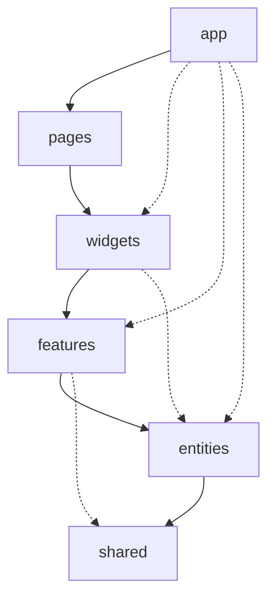
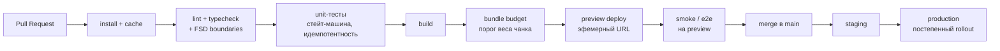

# 05 · Фронт-архитектура

## О чём этот документ

Тема проекта — надёжное выполнение долгих асинхронных AI-задач в Selene SPA (модуль
TASS). Раньше мы разложили это на бизнес-возможности и логические сервисы
([04-decomposition](04-decomposition.md)). Здесь смотрим на ту же систему с другой
стороны: как устроен именно фронтенд — как он поделён на слои, как рендерится и
собирается, стоит ли дробить его на микрофронтенды и как всё это выкатывается.

Важная вводная: наш модуль живёт не сам по себе, а внутри большого клиентского
приложения Selene. Роутер, авторизация, дизайн-система и сборка уже есть у хоста. Поэтому
многие решения тут — не «что выбрать с нуля», а «как аккуратно встроиться и не притащить
проблем». Это честно отражено ниже: мы не тянем SSR и не поднимаем микрофронтенды там, где
они не нужны.

Каждое ключевое решение оформлено отдельным ADR (контекст → решение → последствия):

- [ADR-0004 — раскладка фронтенда по FSD](adr/0004-fsd-decomposition.md)
- [ADR-0005 — модель рендеринга и сборки: CSR + code splitting](adr/0005-rendering-build-model.md)
- [ADR-0006 — монорепозиторий, а не микрофронтенды](adr/0006-monorepo-vs-microfrontend.md)

## Связь с атрибутами качества

Всё, что ниже, работает на те же три приоритетных свойства из [ДЗ-1](03-quality-attributes.md):

| Атрибут | Как его усиливает фронт-архитектура |
|---|---|
| **Изменяемость** | Слои FSD и публичные API модулей; новый тип задачи — это конфиг + свой чанк, а не правка ядра |
| **Надёжность** | Стейт-машина и идемпотентность живут в одном слое (`entities/task`), проверяются юнит-тестами в CI |
| **Устойчивость** | Восстановление задач и персистентность — отдельная фича с чётким портом, не размазаны по UI |

## Декомпозиция по FSD

Берём Feature-Sliced Design: слои сверху вниз, зависимости — только вниз, между соседями
по одному слою прямых импортов нет. Каждый слой делится на слайсы (по смыслу), слайс — на
сегменты (`ui`, `model`, `api`, `lib`, `config`). Наружу слайс отдаёт только свой
публичный API (`index.ts`), внутренности не импортируются напрямую.

### Слои и что в них лежит

| Слой | Что здесь для нашей темы | Примеры слайсов |
|---|---|---|
| **app** | Точка монтирования в хост: провайдеры стора, регистрация фичей. Роутер и авторизацию даёт Selene | `providers`, `mount` |
| **pages** | Тонкие экраны-композиции. У нас модуль встраивается в чужие страницы, поэтому слой почти пустой | — (композиция на стороне хоста) |
| **widgets** | Самостоятельные куски UI из фичей и сущностей | `task-feed`, `task-card` |
| **features** | Действия пользователя над задачей — по одному сценарию на слайс | `start-task`, `cancel-task`, `retry-task`, `restore-tasks` |
| **entities** | Ядро домена: модель задачи, стейт-машина, тип задачи, наблюдение | `task`, `task-type`, `observation` |
| **shared** | Общее без доменного смысла: ui-kit хоста, клиент, `job-id`, схемы, адаптеры транспорта | `ui`, `api`, `lib/job-id`, `lib/schema`, `config` |

### Куда легли ключевые вещи из декомпозиции

Чтобы FSD не разошёлся с уже описанной моделью сервисов:

- **Task Orchestrator** (стейт-машина, переходы, deadline, retry, приём результата) →
  `entities/task/model`. Это сердце домена, оно не знает про транспорт и про UI.
- **`TaskExecutionPort`** (контракт `start · observe · cancel`) → объявлен на границе
  `entities/task`, а реализации живут ниже.
- **AI Integration Gateway** (long-poll и Centrifugo) → адаптеры в `shared/api`, они
  реализуют порт. Домен зависит от абстракции, а не от протокола (DIP).
- **Тип задачи** (`createAsyncAiTask`, схема результата, политики) → `entities/task-type`
  плюс конфиги конкретных типов. Новый тип — новый слайс/конфиг, а не правка ядра.
- **Task Feed** (проекция для пользователя) → `widgets/task-feed`, читает read-model из
  событий, а не таблицы оркестратора.
- **Персистентность** (валидируемая схема вместо пустого `rtRecord`) → `shared/lib/schema`
  + адаптер хранилища за портом.

### Правило зависимостей

Стрелка = «может импортировать». Наверх импортов нет вообще: `entities` ничего не знает про
`features`, `shared` не знает ни про кого. Внутри одного слоя слайсы не ходят друг к другу
напрямую (например, `start-task` не лезет в потроха `cancel-task`) — только через нижние
слои или общий контракт. Это и есть страховка изменяемости: правка одной фичи не расползается.

### Чего сознательно избегаем

- **God-slice** «task» на весь домен: не сваливаем UI, транспорт и правила в один слайс —
  именно от этого уходим (сейчас каждый консьюмер по ~490 строк делает всё сразу).
- **Импорты «снизу вверх» и в обход публичного API** — их ловим линтером границ
  (`eslint-plugin-boundaries` / steiger), а не на ревью «на глаз».
- **Утечка транспорта в домен**: `entities/task` не импортирует `shared/api` напрямую,
  только через порт.

## Модель рендеринга и сборки

Полное обоснование — в [ADR-0005](adr/0005-rendering-build-model.md), здесь суть.

**Рендеринг — CSR.** Наш модуль показывается уже после авторизации, данные приватные и
живые (статус задачи меняется каждые секунды), а сама Selene — клиентское SPA. SSR/SSG тут
не дают выигрыша в LCP: первый экран всё равно рисует хост, а наш контент персональный и
не кэшируется на CDN. Платить за SSR-сервер и гидратацию ради интерактивного пост-авторного
виджета смысла нет.

**Почему это не «по умолчанию», а по метрикам:**

| Метрика | Кто на неё влияет | Наш рычаг |
|---|---|---|
| **TTFB** | оболочка Selene (её сервер/CDN) | вне нашего контроля; SSR модуля его не улучшит |
| **LCP** | первый значимый экран хоста | наш модуль догружается лениво и не должен его тормозить |
| **INP / TTI** | размер и работа JS нашего модуля | держим чанк маленьким, тяжёлое грузим по требованию |

Отсюда вывод: раз TTFB/LCP определяет хост, наш главный рычаг — **вес и момент загрузки
JS**. Значит, ключевое решение по сборке — не рендеринг, а code splitting.

**Сборка — бандлер хоста (Vite/webpack), с делением на чанки:**

- каждый **тип задачи** и его тяжёлый рендер результата грузятся динамическим импортом —
  добавление нового типа не раздувает начальный бандл;
- ядро (`entities/task`) попадает в общий чанк модуля, транспортные адаптеры — отдельно,
  чтобы неиспользуемый транспорт не тянулся;
- общие зависимости (React, ui-kit) берём из хоста, не дублируем;
- в CI стоит **бюджет бандла** — если чанк модуля вырос сверх порога, сборка падает.

## Масштабирование: монорепо, а не микрофронтенды

Полное обоснование — в [ADR-0006](adr/0006-monorepo-vs-microfrontend.md).

Модуль уже живёт в монорепозитории Selene, у него одна команда, общая дизайн-система и
тесная связь с роутером и авторизацией хоста. Микрофронтенды (Module Federation и т.п.)
дали бы независимый деплой — но за него пришлось бы платить рантайм-интеграцией, риском
рассинхрона версий общих зависимостей и, что важнее для темы, размазанной по границе
гарантией доставки: контракт «ровно один результат, идемпотентность по `job-id`» проще
удержать в одном рантайме, чем через границу федерации.

Независимый релиз нам сейчас не нужен: SLA — это SLA всего SPA Selene, отдельного у модуля
нет. Поэтому осознанно **отказываемся от микрофронтендов** и остаёмся модулем в монорепо.
Чтобы решение не стало ловушкой, держим FSD-границы и публичные API: если завтра модуль
понадобится вынести в пакет или отдельный фронт — это будет вынос по уже готовому шву, а не
разбор монолита.

| | Монорепо-модуль (выбор) | Микрофронтенд |
|---|---|---|
| Деплой | вместе с Selene | независимый |
| Общие зависимости | одна версия, без дублей | риск рассинхрона, дубли в рантайме |
| Гарантия доставки задачи | в одном рантайме, проще | через границу федерации, сложнее |
| Поддержка / SLA | общий SLA хоста, одна команда | свой контур, оправдан при отдельной команде |
| Когда оправдано | наш случай | много команд, разные релиз-циклы |

## Эскиз CI/CD

Один пайплайн на пул-реквест, три окружения, обязательные гейты завязаны на атрибуты качества.

| Этап | Что проверяет | С каким атрибутом связан |
|---|---|---|
| lint + typecheck + границы FSD | стиль, типы, отсутствие импортов в обход слоёв | изменяемость |
| unit-тесты | переходы стейт-машины, идемпотентность по `job-id`, восстановление | надёжность, устойчивость |
| bundle budget | чанк модуля не перерос порог | производительность (вес JS) |
| preview deploy | ветка поднимается на отдельном URL для ручной проверки и e2e | обратная связь до мержа |
| staging → production | прогон на staging, затем постепенный выкат | безопасность релиза |

**Окружения:**

- **Preview** — эфемерное, поднимается на каждый PR, гасится после мержа. Именно тут гоняем
  smoke/e2e и показываем ревьюеру живой модуль.
- **Staging** — стабильное, максимально близкое к проду, для интеграционной проверки с Selene.
- **Production** — выкат постепенный (доля пользователей растёт), с возможностью быстрого
  отката, потому что приоритет темы — надёжность и устойчивость.

## Итог

Фронтенд разложен по FSD с явными границами и правилом «зависимости только вниз»; домен
(стейт-машина и порт) отделён от транспорта и UI. Рендеринг — CSR, потому что модуль
интерактивный, приватный и встроен в клиентское SPA; главный рычаг — не SSR, а code
splitting под метрику веса JS. От микрофронтендов отказываемся осознанно: нужный масштаб
закрывается монорепо-модулем, а FSD-швы оставляют путь к выделению на будущее. CI/CD —
короткий пайплайн с preview-окружением и гейтами, привязанными к атрибутам качества из ДЗ-1.
