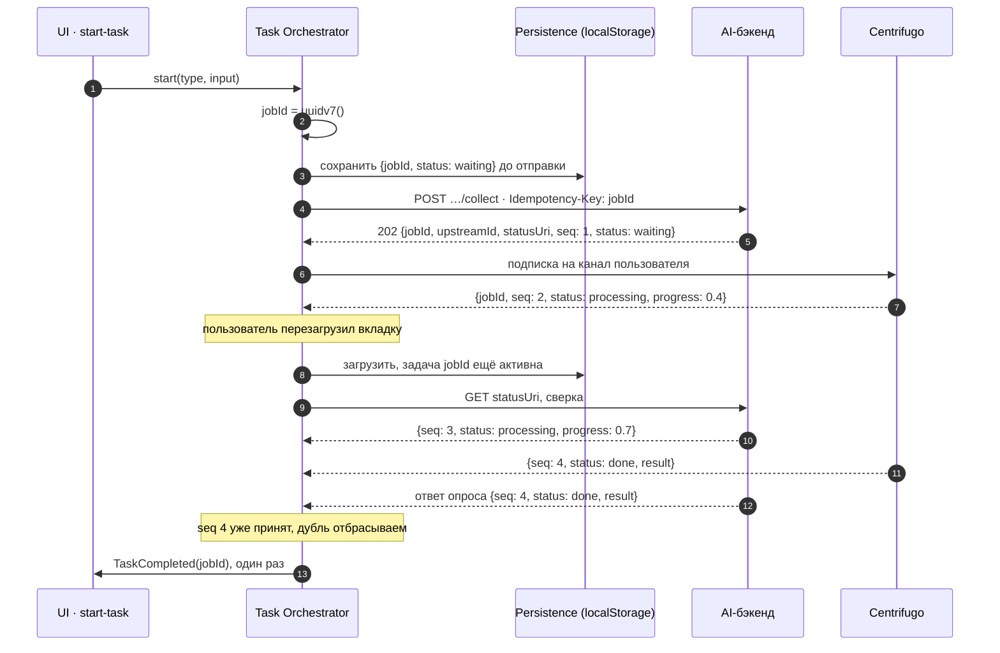
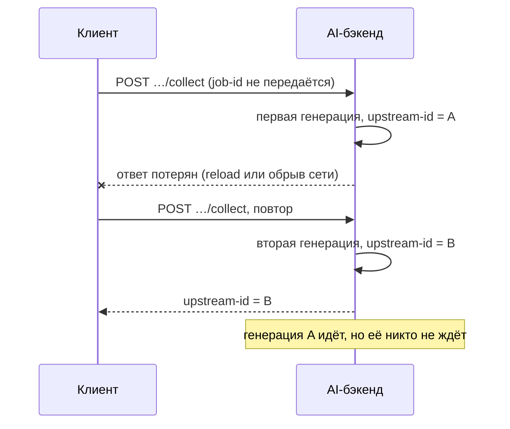

# 06 · Модель взаимодействия: sync/async, контракты, брокер и идемпотентность

## О чём этот документ

В [ADR-0001](adr/0001-delivery-guarantees.md) мы решили, что задачу лучше повторить, чем
потерять, то есть выбрали at-least-once. У этого решения есть обратная сторона: любой шаг
может выполниться дважды, а сообщения могут приходить в любом порядке. В этом документе
разбираемся, как с этим жить. Сначала решаем, какие взаимодействия делать синхронными, а
какие нет, и описываем контракты. Потом выбираем брокер. И в конце проходим по операциям,
которые опасно повторять, и для каждой придумываем защиту.

Решения вынесены в два ADR:

- [ADR-0007 — модель взаимодействия и выбор брокера](adr/0007-interaction-model-and-broker.md)
- [ADR-0008 — идемпотентность](adr/0008-idempotency.md)

## Почему at-least-once требует идемпотентности

Клиент отправил запрос и не дождался ответа. Он не знает, что случилось: запрос не дошёл
или дошёл, а потерялся ответ. Снаружи оба случая выглядят одинаково. Если задачу нельзя
терять, остаётся только отправить ещё раз, а значит, сервер должен спокойно переживать один
и тот же запрос дважды.

У нас повторы появляются вот откуда:

- пользователь перезагрузил страницу, пока шёл `POST`, ответ не успел сохраниться, и после
  рестарта очередь отправляет запрос заново (`polling_queue` так делает уже сейчас);
- сеть ответила таймаутом или 5xx, и клиент повторил запрос;
- открыты две вкладки, и обе подняли одну и ту же задачу из общего localStorage;
- один и тот же `done` пришёл и через опрос, и через Centrifugo;
- после переподключения Centrifugo отдал историю канала, а часть её клиент уже видел.

Exactly-once между браузером и бэкендом не получится: сеть, вкладка и сервер падают
независимо друг от друга. Поэтому мы и не пытаемся. Доставляем хотя бы один раз, а
повторы гасим на стороне получателя. Снаружи это выглядит как «ровно один результат».

## Карта взаимодействий: sync или async

### Стыки, которые есть сейчас

У платформы три внешних стыка. Для каждого ниже указано, кто кого ждёт, какую модель
взаимодействия берём и что случится, если запрос или сообщение придёт повторно.

| Стык | Кто кого ждёт | Модель | Почему так | Что будет при повторе |
|---|---|---|---|---|
| Старт генерации группы или блока, `POST …/collect` | клиент ждёт только ответа «принято», сам результат не ждёт | синхронная команда, результат потом (async request-reply) | генерация идёт минутами, а держать открытый запрос столько нельзя: прокси рвёт соединение примерно через минуту, а перезагрузка страницы его убивает. От `POST` нам нужно только одно: узнать, где спрашивать статус | **сейчас**: вторая генерация (подробнее [ниже](#доходит-ли-job-id-до-бэкенда)). **цель**: бэкенд узнаёт повтор по `Idempotency-Key` и возвращает ту же задачу |
| Опрос статуса, `GET <uri>` | клиент ждёт ответа на каждый запрос, но не ждёт результата генерации | синхронный pull по таймеру, с backoff | бэкенд генерации пока не умеет push; опрос надёжен, каждый ответ — свежее состояние | ничего страшного: `GET` ничего не меняет. Опасен только сам ответ, если он пришёл позже более свежего push (см. [порядок](#коммутативность-когда-порядок-не-гарантирован)) |
| Ответ ассистента в чате, WebSocket через Centrifugo | клиент никого не ждёт, он подписан на канал | асинхронный push (pub/sub) | ответ приходит кусками, на опросе он бы появлялся рывками и нагружал бэкенд. Centrifugo уже есть и работает | после переподключения Centrifugo отдаёт историю, и часть фрагментов придёт второй раз. Их отсеиваем по номеру фрагмента |

### Что добавляется в целевой модели

| Стык | Модель | Почему так |
|---|---|---|
| Статус генерации через Centrifugo | асинхронный push | статус приходит сразу, без лишних запросов; опрос остаётся подстраховкой |
| Отмена, `DELETE <uri>` | синхронно | человек нажал кнопку и ждёт подтверждения |
| Применение результата, `PUT` блока по id из `jobId` | синхронно | это изменение в чужом сервисе, и повтор должен быть безвредным сам по себе |

Внутри SPA всё проще. UI вызывает фичу `start-task` синхронно и сразу получает `jobId`, а
Task Feed и Telemetry узнают о задаче из событий Effector. Отдельный брокер им не нужен:
всё работает в одном рантайме, и падение телеметрии не ломает задачу.

Если коротко: синхронно делаем только то, что быстро и чего человек ждёт прямо сейчас.
Всё, что длится дольше пары секунд, уходит в асинхронную часть.

### Три случая, где выбор неочевиден

**Старт генерации выглядит синхронным, но по смыслу он асинхронный.** `POST` возвращает
ответ сразу, но в этом ответе нет результата, только адрес, где его ждать. Если перепутать
и начать ждать результат в самом `POST`, вернётся проблема с таймаутами прокси.

**Опрос — это синхронный вызов внутри асинхронной модели.** Каждый `GET` синхронный, но
задача в целом от них не зависит. Пропущенный опрос ничего не ломает, следующий вернёт то
же самое состояние, только свежее.

**Push и опрос работают вместе.** Push быстрый, но при разрыве может что-то потерять.
Опрос медленнее, зато всегда отдаёт текущее состояние. Поэтому push — основной канал, а
опрос подстраховывает. Сливать их несложно: оба приходят в один `TaskExecutionPort`
([ADR-0002](adr/0002-transport-port.md)), а порядок, в котором они пришли, не важен.

### Основной сценарий



## Доходит ли job-id до бэкенда

Сейчас не доходит, и это самая важная дыра в теме.

`job-id` рождается на клиенте и живёт только там: по нему очередь находит задачу в
localStorage. В `POST …/collect` он не передаётся. Бэкенд создаёт генерацию и сам выдаёт
свой идентификатор, upstream-id, вместе с адресом для опроса. Связку `job-id ↔ upstream-id`
хранит клиент, точнее AI Integration Gateway ([декомпозиция](04-decomposition.md)).

Что из этого выходит, если ответ на `POST` потерялся:



Бэкенд видит два одинаковых запроса и не может понять, что это повтор: у них нет ничего
общего. Запускаются две платные генерации. Дедупликация на клиенте тут уже не поможет:
клиент узнал только про B, а про A не знает вообще, и отменить её не может. Защита на
клиенте спасает от двойного рендера результата, но не от двойной генерации.

Поэтому решаем так: **`job-id` передаётся в `POST …/collect` заголовком
`Idempotency-Key`**. Бэкенд хранит связку «ключ → upstream-id». Если с этим ключом пришёл
повтор, он не запускает новую генерацию, а возвращает тот же upstream-id и текущий статус.
Тогда в сценарии выше второй `POST` вернёт A, а генерации B не будет вовсе.

Это доработка бэкенда, и сделать её можно не сразу. До этого окно для двойной генерации
остаётся, и мы о нём знаем (см. [план внедрения](#план-внедрения)).

## Контракты API

Сейчас у бэкенда есть `POST …/collect` и `GET <uri>`. Мы их не выбрасываем, а дорабатываем:
добавляем `Idempotency-Key`, номер версии `seq` и одинаковый формат ответа для старта,
статуса и push.

### Единый job-контракт

Старт, статус и push отвечают одним и тем же снимком задачи. Отличаются только запрос на
старт и обёртка push-сообщения. В [декомпозиции](04-decomposition.md) снимок называется
«наблюдением».

```ts
// запрос на старт: POST …/collect, заголовок Idempotency-Key: <jobId>
interface StartRequest {
  schemaVersion: 1
  type: 'ai-group' | 'ai-block' | 'chat-reply'
  typeVersion: number    // версия конфига типа задачи
  input: unknown         // формат зависит от type
}

// ответ на старт, ответ на опрос и содержимое push — один и тот же снимок
interface TaskSnapshot {
  schemaVersion: 1
  jobId: string          // UUIDv7, его генерирует клиент; он же Idempotency-Key
  upstreamId: string     // id генерации на бэкенде
  statusUri: string      // где спрашивать статус
  type: 'ai-group' | 'ai-block' | 'chat-reply'
  status: 'waiting' | 'processing' | 'done' | 'failed' | 'canceled'
  seq: number            // версия задачи на сервере, растёт на 1 при каждом изменении
  progress?: number      // от 0 до 1
  result?: unknown       // формат зависит от type, проверяем через Runtypes
  error?: { code: string; retryable: boolean }
  updatedAt: string      // ISO-8601, только для показа; сортировать по нему нельзя
}

// push-сообщение в канале Centrifugo
interface TaskPush {
  schemaVersion: 1
  kind: 'task.snapshot' | 'task.chunk'
  snapshot?: TaskSnapshot                         // для task.snapshot
  chunk?: { jobId: string; index: number; text: string }   // для стриминга чата
}
```

Какие поля где есть:

| Поле | Ответ на старт | Ответ на опрос | Push | Зачем |
|---|---|---|---|---|
| `schemaVersion` | да | да | да | понять, умеем ли мы читать это сообщение |
| `jobId` | да | да | да | связать ответ с задачей на клиенте; ключ идемпотентности |
| `upstreamId`, `statusUri` | да | да | да | где задача живёт на бэкенде |
| `status` | да (`waiting`) | да | да | текущий статус |
| `seq` | да (`1`) | да | да | упорядочить ответы из разных каналов |
| `progress` | нет | если есть | если есть | показать прогресс |
| `result` | нет | при `done` | при `done` | результат задачи |
| `error` | нет | при `failed` | при `failed` | что пошло не так и можно ли повторить |

Статуса `timeout` в контракте нет, и это сделано нарочно. Таймаут ставит сам клиент, когда
истёк его дедлайн, а сервер о нём ничего не знает.

### Как меняется версия

`schemaVersion` есть в каждом сообщении. Правила простые:

- новое необязательное поле добавляем без смены версии; клиент игнорирует поля, которых не
  знает;
- если поле удаляется, меняет смысл или становится обязательным, это новая
  `schemaVersion`; какое-то время бэкенд отдаёт обе версии;
- клиент проверяет каждое сообщение через Runtypes. Если `schemaVersion` незнакомая или
  сообщение не проходит проверку, клиент его не применяет, пишет в телеметрию и делает
  обычный `GET`. Сломанное сообщение не должно ломать задачу;
- `typeVersion` в запросе на старт — это версия конфига типа задачи, а не схемы. Она
  нужна, чтобы бэкенд знал, в каком формате вернуть `result`.

### HTTP

| Операция | Запрос | Ответы | Повтор безопасен? |
|---|---|---|---|
| Старт | `POST …/collect`<br/>`Idempotency-Key: <jobId>`<br/>`StartRequest` | `202` + `Location` + снимок: задача принята<br/>`200` + `Idempotent-Replayed: true` + текущий снимок: такой ключ уже был<br/>`409` + `Retry-After`: первый запрос с этим ключом ещё обрабатывается<br/>`422`: ключ тот же, а тело другое<br/>`400`: ключа нет | да, но только благодаря ключу: сам по себе `POST` не идемпотентен |
| Статус | `GET <statusUri>`<br/>`If-None-Match: "<seq>"` | `200` + снимок + `ETag: "<seq>"` + `Retry-After` (когда спросить снова)<br/>`304`: ничего не поменялось<br/>`404`: сервер про задачу не знает | да, `GET` ничего не меняет |
| Отмена | `DELETE <statusUri>` | `202`: отмену приняли<br/>`200` + снимок: задача уже завершена, ничего не меняем | да, второй `DELETE` оставит всё как есть |
| Применение результата | `PUT /guides/{guideId}/blocks/{blockId}`<br/>`blockId = uuidv5(jobId, 'apply')` | `201` или `200` | да, `PUT` по одному и тому же id просто перезапишет блок |

Пара моментов, которые легко упустить.

`404` на запрос статуса — это не ошибка. Скорее всего, перезагрузка оборвала `POST`, и
сервер задачу так и не получил. Клиент отправляет `POST` ещё раз с тем же `jobId`, и это
безопасно как раз благодаря ключу.

`Retry-After` в ответе на опрос позволяет серверу самому решать, как часто его опрашивать.
Сейчас backoff зашит в код двух консьюмеров, и зашит по-разному. Теперь он становится
частью контракта.

Отмена уже завершённой задачи отвечает `200`, а не `409`. Клиенту всё равно, отменил ли
он задачу сам или она к этому моменту уже закончилась: в обоих случаях он получает
итоговый снимок и показывает его.

### Centrifugo

Канал один на пользователя: `ai_tasks:user#{userId}`. Отдельный канал на каждую задачу не
заводим: тогда пришлось бы подписываться заново на каждую новую задачу, а так после
перезагрузки достаточно одной подписки.

В канал публикуется `TaskPush`. Для генерации это полный снимок, то есть текущее
состояние, а не изменение. Для стриминга чата это нумерованный фрагмент ответа.

У канала включены история и recovery. Клиент запоминает `offset` и `epoch` последней
публикации, которую он принял, и после переподключения получает всё, что пропустил. Если
Centrifugo отвечает, что восстановить не может (история уже вытеснена), клиент делает
`GET` по всем своим активным задачам.

### Порт и события внутри SPA

```ts
interface TaskExecutionPort {
  start(cmd: { jobId: string; type: string; input: unknown }): Promise<TaskSnapshot>
  observe(jobId: string): Stream<TaskSnapshot>   // здесь сливаются push и опрос
  cancel(jobId: string): Promise<TaskSnapshot>
}

// публикует Orchestrator, слушают Task Feed и Telemetry
interface TaskEvent {
  eventId: string        // `${jobId}:${seq}`, считается из данных, а не генерируется случайно
  jobId: string
  seq: number
  kind: 'TaskStateChanged' | 'TaskCompleted'
  snapshot: TaskSnapshot
}
```

`eventId` собирается из `jobId` и `seq`, поэтому одно и то же изменение даёт один и тот же
`eventId`, даже если пришло дважды. По нему потребитель и отсеивает дубли.

## Брокер

Брокер нужен нам ровно в одном месте: чтобы доставить изменение статуса с сервера в
браузер. Внутри SPA сетевой брокер ни к чему: Orchestrator, Task Feed и Telemetry работают
в одном рантайме, и им хватает обычных событий Effector.

| Вариант | Что хорошо | Что плохо | Итог |
|---|---|---|---|
| Без брокера, только опрос | проще некуда, работает уже сейчас | задержка равна интервалу опроса, лишняя нагрузка на бэкенд, чат так не сделать | оставляем как подстраховку |
| Centrifugo | уже работает в проде для чата; есть персональные каналы, история и recovery; масштабируется отдельно от бэкенда | сам по себе доставку не гарантирует, история ограничена | **берём** |
| SSE прямо из бэкенда | стандартная штука, отдельный компонент не нужен | бэкенду придётся держать тысячи открытых соединений, recovery писать самим, и рядом с Centrifugo появится второй push | нет |
| Kafka или RabbitMQ до браузера | — | браузер к ним напрямую не подключится, всё равно нужен WebSocket-шлюз | не подходит |

Берём Centrifugo для push, опрос оставляем подстраховкой. Главная причина практическая:
Centrifugo уже есть в продакшене и его кто-то поддерживает, а перевести генерацию с опроса
на push — это поменять адаптер ([ADR-0002](adr/0002-transport-port.md)). Доставку
Centrifugo не гарантирует, но нам это и не нужно. Сообщения у нас несут полное состояние,
а опрос его сверяет. Если какая-то публикация потерялась, пользователь увидит результат
чуть позже, но ничего не сломается.

Отдельно про серверный этап ([ADR-0003](adr/0003-task-state-store.md)). Когда появится
серверный job-сервис, воркерам генерации понадобится очередь заданий. Тут подойдёт
RabbitMQ: quorum queues, ручной ack, DLX для сообщений, которые раз за разом падают,
отложенный retry. Kafka здесь избыточна. Нам нужна рабочая очередь, а не журнал, который
можно перечитать, нагрузка небольшая, а строгий порядок сообщений по задаче не нужен (почему —
ниже). В Centrifugo сервис будет публиковать через transactional outbox, чтобы не вышло
так, что состояние в базе сохранилось, а событие не ушло. Но это пока планы, не часть
текущего решения.

## Операции, критичные к повтору

| # | Операция | Что будет, если повторить без защиты | Насколько страшно | Как защищаем |
|---|---|---|---|---|
| 1 | Старт генерации (`POST …/collect`) | вторая платная генерация с другим upstream-id; клиент про первую даже не узнает | сильно | `jobId` передаём в `POST` как `Idempotency-Key` и сохраняем до отправки; на клиенте эту проблему не решить |
| 2 | Orchestrator принимает результат | два `TaskCompleted`, результат рисуется дважды | сильно | Idempotent Receiver: из терминала нет переходов, дубли отсекаем по `seq` |
| 3 | Результат применяется к документу (вставили AI-блок, создали группу на карте) | в гайде два одинаковых блока | сильно | `PUT` по `blockId = uuidv5(jobId)` |
| 4 | Восстановление после перезагрузки | задача стартует заново с новым id, получается дубль | сильно | id берём из хранилища, новый не генерируем; сначала `GET`, а `POST` с тем же ключом только при `404` |
| 5 | Статус приходит и опросом, и через WS, плюс история после переподключения | прогресс откатывается назад, статус «моргает» | заметно | шлём снимки состояния, сливаем по наибольшему `seq` |
| 6 | Одну задачу ведут две вкладки | двойные запросы, вкладки перетирают друг другу localStorage | заметно | одна вкладка-лидер на задачу через Web Locks API, остальные только читают |
| 7 | Отмена (`DELETE`) | ничего | почти не страшно | `DELETE` и так идемпотентен |
| 8 | Опрос статуса (`GET`) | ничего | не страшно | `GET` ничего не меняет |
| 9 | События для Task Feed и Telemetry | лишняя карточка, завышенные метрики | несильно | upsert по `jobId` в ленте, дедуп по `eventId` в телеметрии |

## Ключ идемпотентности

Ключ — сам `jobId`. Это UUIDv7: его можно сгенерировать на клиенте без согласования с
сервером, он сортируется по времени и удобен в логах. Отдельный ключ не заводим: задача и
так единица, которую нельзя выполнить дважды. В [ADR-0001](adr/0001-delivery-guarantees.md)
это уже было зафиксировано, здесь только расписываем, как это работает.

Самое важное правило — сохранить ключ до отправки. Порядок строгий: сгенерировали,
сохранили в localStorage и только потом отправили. Если сделать наоборот, перезагрузка
между отправкой и сохранением даст новый ключ, и защита не сработает как раз в том случае,
ради которого её делали.

Ключ привязан к намерению пользователя, а не к конкретной попытке. Сетевой ретрай, повтор
после перезагрузки, повтор из второй вкладки — везде один и тот же `jobId`. Новый `jobId`
появляется, только когда пользователь сам нажал «сгенерировать ещё раз»: значит, он хочет
новый результат.

На сервере ключ ищется в паре с пользователем (`userId`, `jobId`), так что чужим ключом
чужой ответ не получить. Рядом с ключом сервер хранит хеш тела запроса. Если ключ тот же, а
тело другое, это баг на клиенте, а не повтор, и сервер отвечает `422` вместо того, чтобы
молча вернуть старый результат.

Ключ живёт 24 часа. Это с большим запасом больше клиентского потолка в 7 минут и любого
разумного времени, через которое вкладку открывают снова. Если повтор придёт позже, сервер
создаст новую задачу, и мы с этим согласны.

Если второй запрос с тем же ключом пришёл, пока первый ещё обрабатывается, сервер отвечает
`409` с `Retry-After` и не запускает вторую генерацию параллельно.

Хранятся ключи в таблице `idempotency_keys(user_id, key, request_hash, status, response,
created_at)` с уникальным индексом по (`user_id`, `key`). Ключ записывается в той же
транзакции, что и сама задача. Если разнести это на два шага, между «проверили ключ» и
«создали задачу» снова появится щель для дубля.

## Idempotent Receiver

Ключ на старте защищает от наших собственных повторов. Но дубли приходят и с другой
стороны: из истории Centrifugo, из двух транспортов сразу, из второй вкладки. Против них
нужен получатель, который сам понимает, что это сообщение он уже обработал, и ничего не
делает второй раз. Это и есть Idempotent Receiver. У нас таких получателей три.

### Orchestrator принимает статусы

Здесь не нужно хранить список всех увиденных сообщений. Достаточно помнить для каждой
задачи номер последней принятой версии, `lastSeq`. Он лежит в той же записи в хранилище,
что и сама задача.

```ts
function receive(job: Job, obs: TaskSnapshot): Job {
  if (isTerminal(job.status)) return job          // задача завершена, больше ничего не меняем
  if (obs.seq <= job.lastSeq) return job          // дубль или старое сообщение, пропускаем
  const next = transition(job, obs)               // проверяем, что такой переход допустим
  if (isTerminal(next.status)) emit(TaskCompleted(next))   // срабатывает один раз
  return { ...next, lastSeq: obs.seq }
}
```

Почему номер версии, а не список id. Список растёт бесконечно, его надо чистить по TTL, и
он ловит только точные дубли. Одно число на задачу места не занимает и заодно отсеивает
устаревшие сообщения, которые пришли позже новых.

`TaskCompleted` отправляется только в момент перехода в терминальный статус. А из
терминального статуса переходов нет, так что второй раз это событие случиться просто не
может. Защита от дублей тут встроена в саму стейт-машину, отдельно её прикручивать не
приходится.

### Task Feed обновляет ленту

Лента обновляет карточку по `jobId` и берёт снимок с наибольшим `seq`. Если событие
пришло повторно, карточка перезапишется тем же самым содержимым. Никакого отдельного
журнала для этого не нужно.

### Telemetry считает метрики

Это единственное место, где событие действительно означает факт («ещё одна задача
завершилась»), а не текущее состояние. Поэтому здесь дедуп по `eventId = jobId:seq` делает
сама платформа телеметрии. Если дубль всё же проскочит, метрика немного завысится. Это
неприятно, но не страшно: на состояние задач телеметрия не влияет.

### На сервере

Когда появится серверный воркер, он будет брать задания из RabbitMQ по обычной схеме
inbox. В одной транзакции он вставляет пару (`consumer`, `message_id`) в таблицу с
уникальным индексом и выполняет работу. Если вставка упала на уникальности, значит, это
сообщение уже обработано: воркер подтверждает его и ничего не делает.

## Коммутативность: когда порядок не гарантирован

Опрос и push — два независимых канала, и порядок между ними никто не обещает. Ответ на
`GET`, отправленный раньше, вполне может прийти позже свежей публикации из Centrifugo. А
recovery после переподключения подмешивает старые сообщения после новых. Раз порядок
гарантировать нельзя, нужно сделать так, чтобы он ни на что не влиял.

Тут важно, что именно лежит в сообщении: изменение или состояние. Сообщение-изменение
(«прогресс +10%», «допиши кусок текста») ломается и от повтора, и от перестановки: дважды
прибавили 10% — получили лишние 10%. Сообщение-состояние («сейчас `processing`, прогресс
0.7, версия 12») можно применять сколько угодно раз и в любом порядке, если правильно его
сливать:

```text
merge(a, b) = b.seq > a.seq ? b : a
```

То есть из двух снимков побеждает тот, у которого версия больше. Результат не зависит ни от
порядка (`merge(a, b) = merge(b, a)`), ни от группировки, ни от повторов
(`merge(a, a) = a`). Поэтому каналы можно сливать как угодно, итог будет один и тот же.

Как это выглядит на практике. Задача уже в `processing` с `seq = 3`, и дальше сообщения
приходят вперемешку:

| Что пришло | Откуда | Что делаем | Статус после |
|---|---|---|---|
| `done`, `seq 5` | push | принимаем, задача завершена, `TaskCompleted` | `done` |
| `processing`, `progress 0.9`, `seq 4` | ответ опроса, отправленного раньше | `seq` меньше последнего, пропускаем | `done` |
| `done`, `seq 5` | ответ следующего опроса | это дубль, пропускаем | `done` |
| `processing`, `seq 3` | история Centrifugo после переподключения | задача уже в терминале, пропускаем | `done` |

Если бы мы просто применяли всё подряд, задача после `done` откатилась бы в `processing`, а
у пользователя пропал бы результат. С правилом «побеждает большая версия, из терминала не
выходим» статус только идёт вперёд.

Несколько вещей, о которых стоит помнить.

Сортируем по `seq` от сервера, а не по `updatedAt`. Часы клиента и сервера расходятся, а
две записи в одну миллисекунду не упорядочить вообще. `seq` выдаёт один владелец задачи,
поэтому порядок по нему однозначный.

Статусы идут только вперёд: `waiting`, потом `processing`, потом терминальный. Поэтому
даже без `seq` можно сливать по «старшинству» статуса, и задача никогда не откатится из
`done` обратно в `processing`.

Стриминг ответа в чате по природе состоит из кусочков, то есть из изменений. Его тоже можно
сделать устойчивым к порядку: у каждого фрагмента есть номер, клиент складывает фрагменты в
`Map<index, text>` и показывает их подряд, пока не встретит пропуск. Повторный фрагмент
перезапишет ту же ячейку, а перестановка ничего не изменит. Если пропуск не закрывается,
клиент делает `GET` и получает полный ответ.

Таймаут на клиенте — тоже терминальный статус, только локальный. Если `done` пришёл уже
после таймаута, задача остаётся в `timeout` (из терминала переходов нет), а в телеметрию
уходит `late_result`. Чтобы такое случалось реже, перед тем как объявить таймаут,
Orchestrator последний раз делает `GET`: вдруг результат уже лежит на сервере.

## План внедрения

Бэкенд сразу не поменять, поэтому идём в два шага.

| Шаг | Что делаем | Что это закрывает | Что остаётся |
|---|---|---|---|
| 1, только клиент | сохраняем `jobId` до отправки; делаем Idempotent Receiver с `lastSeq` и терминалом без выхода; назначаем вкладку-лидера через Web Locks; результат применяем только по единственному `TaskCompleted` | повторы 2, 4, 5, 6, 9 и частично 3 | дубль генерации, если перезагрузка случилась уже после того, как сервер принял `POST` (клиент тут ничего сделать не может, см. [раздел про job-id](#доходит-ли-job-id-до-бэкенда)); дубль блока, если перезагрузка случилась между вставкой блока и сохранением терминала |
| 2, бэкенд | `Idempotency-Key` на старте, `seq` в снимке, `Retry-After`, публикация снимков в Centrifugo, `PUT` блока по id из `jobId` | повторы 1 и 3 полностью; генерация переезжает на push | — |

Пока бэкенд не отдаёт `seq`, сливаем по старшинству статуса и по `progress`. Это слабее,
но тоже не даёт статусу откатиться назад.

## Связь с атрибутами качества

| Атрибут и ASR | Что здесь на него работает |
|---|---|
| Надёжность, ASR-5 | ключ идемпотентности на старте, Idempotent Receiver, `PUT` при применении результата |
| Устойчивость, ASR-1 и ASR-2 | ключ сохраняется до отправки; на `404` старт безопасно повторяется; перед таймаутом последний `GET` |
| Изменяемость, ASR-4 | один `TaskSnapshot` для HTTP и WS, транспорт можно менять, не трогая правила слияния |
| Наблюдаемость, ASR-6 | `eventId` считается из данных; поздние результаты видны в отдельной метрике `late_result` |

### QAS-3 · Корректность повторов

| Часть | Значение |
|---|---|
| Источник | сеть, браузер, инфраструктура доставки |
| Стимул | один и тот же старт ушёл три раза (ретрай, перезагрузка и вторая вкладка); `done` пришёл и опросом, и через WS; после переподключения Centrifugo ещё раз отдал историю |
| Артефакт | Task Orchestrator, AI-бэкенд, Task Feed |
| Среда | обычная работа, задача в статусе `processing` |
| Отклик | на сервере одна задача; Orchestrator один раз переходит в `done`; у пользователя одна карточка; в гайде один блок |
| Мера отклика | на один `jobId`: платных генераций — 1, событий `TaskCompleted` — 1, применённых к документу результатов — 1; откатов статуса назад — 0 |

## Итог

Синхронно у нас только короткие команды. Результат долгой генерации приходит отдельно:
сначала `202 Accepted`, потом push через Centrifugo, а опрос подстраховывает. Centrifugo
выбрали, потому что он уже работает в проде. Когда дойдём до серверного сервиса, для
очереди заданий возьмём RabbitMQ.

Каждую опасную при повторе операцию защищаем по-своему. Старт защищён ключом `jobId`:
он сохраняется до отправки и теперь доходит до бэкенда в `POST …/collect`, так что повтор
не запускает вторую генерацию. Приём результата защищён тем, что Orchestrator помнит
последнюю версию задачи и не выходит из терминального статуса. Изменение документа
защищено `PUT` по id, который считается из `jobId`. Сообщения несут состояние, а не
изменение, и сливаются по наибольшему `seq`, поэтому порядок доставки ни на что не влияет.
Exactly-once мы не обещаем. Мы обещаем, что снаружи результат всегда один, и проверяем это
сценарием QAS-3.

Старт, статус и push отвечают одним и тем же снимком задачи с `schemaVersion` и `seq`.
Поэтому клиенту неважно, по какому каналу пришло обновление: он его проверит, сравнит
версию и либо применит, либо пропустит.
