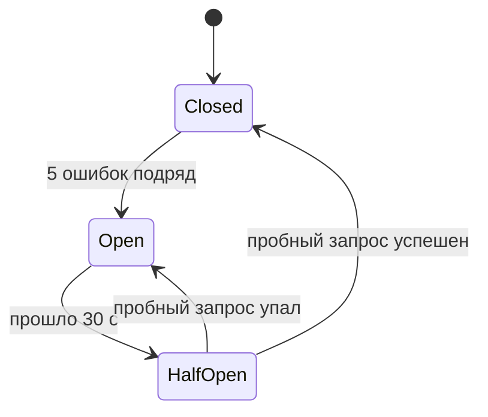
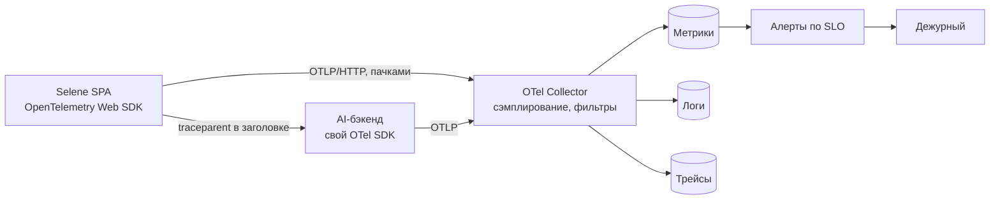

# 07 · Надёжность: тактики отказоустойчивости и план observability

## О чём этот документ

В прошлых домашках мы договорились, как задача живёт: стейт-машина, гарантия
at-least-once, идемпотентность, push плюс опрос. Всё это описывает, как система должна
работать. Здесь разбираем другое: что происходит, когда что-то ломается, и как мы об этом
узнаём раньше пользователя.

Документ состоит из двух частей. В первой — тактики отказоустойчивости: какие отказы
бывают и что платформа делает с каждым. Во второй — план observability: какие метрики
собираем, какие у нас SLI и SLO, на что ставим алерты и что делаем, когда алерт сработал.

Решения вынесены в два ADR:

- [ADR-0009 — тактики отказоустойчивости](adr/0009-fault-tolerance-tactics.md)
- [ADR-0010 — observability: SLO, алерты по симптомам, OpenTelemetry](adr/0010-observability-slo-alerting.md)

## Что для нас значит «надёжно»

Пользователю всё равно, упал ли бэкенд, Centrifugo или его собственная вкладка. Ему
важно три вещи: результат приходит, приходит один раз, а если не пришёл — понятно, что
делать. Отсюда три обещания, на которые работает всё остальное:

1. **Задача не теряется.** Ни перезагрузка, ни обрыв сети, ни падение одного из каналов не
   приводят к тому, что задача исчезла (ASR-1).
2. **Задача всегда заканчивается.** Через какое-то время она приходит в `done`, `failed`,
   `timeout` или `canceled`. Вечного спиннера нет (ASR-2).
3. **Результат один.** Сколько бы ни было повторов, генерация и результат одни (ASR-5).

Есть и то, чего мы не обещаем. Мы не можем сделать так, чтобы AI-бэкенд не падал: он не
наш. Мы можем сделать так, чтобы его падение не превращалось в потерянную задачу, дубль
или зависший интерфейс, и чтобы мы узнали о нём из алерта, а не из чата поддержки.

## Часть 1. Тактики отказоустойчивости

### Какие отказы бывают и что мы с ними делаем

| Отказ | Как замечаем | Что делаем | Что видит пользователь |
|---|---|---|---|
| Бэкенд отвечает 5xx или таймаутом на старт | код ответа, таймаут запроса 10 с | повтор с backoff и jitter, тот же `Idempotency-Key`; не больше 3 попыток | «запускаем…», потом либо задача пошла, либо ошибка с кнопкой «повторить» |
| Бэкенд лежит целиком | подряд 5 ошибок на один эндпоинт | circuit breaker размыкается, опросы этого эндпоинта на паузе 30 с, потом одна пробная попытка | «сервис временно недоступен, задача сохранена»; дедлайн задачи продолжает идти |
| Бэкенд принял задачу, но она застряла в `processing` | дедлайн задачи (7 мин для генерации, 180 с для чата) | перед дедлайном последний `GET`, потом `timeout` | понятное сообщение и кнопка «попробовать ещё раз» |
| Centrifugo недоступен или соединение рвётся | событие disconnect, нет heartbeat | переходим на опрос для всех активных задач; при переподключении восстанавливаем историю | ничего, обновления идут чуть медленнее |
| Centrifugo не смог восстановить историю | ответ recovery «не удалось» | `GET` по всем активным задачам | ничего |
| Пользователь перезагрузил вкладку или она упала | при старте в хранилище есть активные задачи | поднимаем задачи и продолжаем; `jobId` сохраняем до отправки | задача продолжается с того же места |
| Запись в localStorage битая | не прошла проверку Runtypes | запись отбрасываем, задачу по `jobId` пробуем найти через `GET` | в худшем случае задача пропадает из ленты, но не ломает старт модуля |
| localStorage переполнен | исключение `QuotaExceededError` | чистим завершённые задачи старше суток; если не помогло, работаем без сохранения и пишем в телеметрию | задача работает, но не переживёт перезагрузку |
| Открыто несколько вкладок | Web Locks API | одна вкладка-лидер ведёт задачу, остальные только показывают | одинаковая картинка во всех вкладках |
| Ответ бэкенда не той формы | не прошла проверку Runtypes | сообщение не применяем, пишем в телеметрию, ждём следующего | ничего, если это разовая ошибка |
| Массовое восстановление после аварии | — | jitter на всех повторах и опросах, общий бюджет повторов | бэкенд не получает всплеск запросов от всех клиентов разом |

Почти все строки таблицы опираются на то, что уже сделано в прошлых ДЗ. Идемпотентность
делает повторы безопасными, а без неё повторять было бы опасно. Терминальный `timeout`
гарантирует, что задача закончится. Push плюс опрос дают запасной канал. Новое здесь —
то, что защищает уже не задачу, а бэкенд и самого клиента: circuit breaker, бюджет повторов
и изоляция.

### Тактики по группам

Удобно раскладывать тактики на три группы: как заметить отказ, как от него
восстановиться и как сделать так, чтобы он не случался.

**Заметить.** Таймаут на каждый запрос (10 с на `POST`, 10 с на `GET`), чтобы зависший
запрос не держал очередь. Дедлайн на всю задачу. Heartbeat у WebSocket. Проверка каждого
ответа через Runtypes: кривой ответ — это тоже отказ, только тихий.

**Восстановиться.**

- *Повтор с backoff и jitter.* Интервалы растут (1, 2, 4, 8 с, потолок 30 с), а случайный
  разброс не даёт тысячам клиентов прийти одновременно. Повторяем только то, что безопасно
  повторять: `GET`, `DELETE`, `PUT` и `POST` с ключом. На `4xx`, кроме `408`, `409` и `429`,
  не повторяем — это ошибка запроса, повтор её не исправит.
- *Запасной канал.* Если push молчит, работает опрос. Слить их легко, потому что сообщения
  несут состояние ([06-interaction-model](06-interaction-model.md#коммутативность-когда-порядок-не-гарантирован)).
- *Сохранение состояния до действия.* Задача записывается в хранилище до отправки, поэтому
  после падения вкладки её есть откуда поднять.
- *Мягкая деградация.* Если бэкенд недоступен, модуль не падает и не блокирует хост: лента
  показывает задачи со статусом «ждём», новые задачи можно запустить, они встанут в
  очередь.

**Не допустить.**

- *Circuit breaker.* Если эндпоинт раз за разом отвечает ошибкой, мы перестаём его
  дёргать. Иначе каждый клиент добивает и без того лежащий бэкенд, и после его подъёма
  получается всплеск.
- *Бюджет повторов.* На вкладку не больше 10 повторов в минуту на все задачи вместе.
  Повторы — это дополнительная нагрузка, и при массовом отказе они легко удваивают трафик.
- *Изоляция (bulkhead).* У каждого типа задачи своя очередь опроса и свой лимит
  одновременных запросов (по умолчанию 3). Застрявшая генерация групп не забивает опросами
  всю вкладку и не задерживает чат.
- *Одна вкладка-лидер.* Две вкладки не ведут одну задачу, не делают двойных запросов и не
  перетирают друг другу хранилище.

### Circuit breaker

Breaker живёт в AI Integration Gateway, отдельный на каждый эндпоинт бэкенда. Задачи о нём
не знают: для них открытый breaker выглядит как «пока нет новостей».



В закрытом состоянии запросы идут как обычно. В открытом мы их не отправляем, а сразу
считаем неудачными. Через 30 секунд пропускаем один пробный запрос. Если он прошёл,
breaker закрывается, если нет — снова ждём.

Ошибкой для breaker'а считаются `5xx`, таймаут и сетевая ошибка. `4xx` не считаются: это
проблема запроса, а не бэкенда, и из-за одного кривого запроса нельзя отключать опрос для
всех задач.

Дедлайн задачи во время открытого breaker'а продолжает идти. Если бэкенд не поднялся за 7
минут, задача честно уходит в `timeout`. Это важно: breaker защищает бэкенд, но не должен
превращаться в вечный спиннер. Последний `GET` перед таймаутом идёт в обход breaker'а:
если бэкенд уже поднялся, а breaker об этом ещё не знает, мы не потеряем готовый результат.

### Как это работает на сервере

Когда появится серверный job-сервис ([ADR-0003](adr/0003-task-state-store.md)), часть
тактик переедет туда. Повторы генерации будут делать воркеры с DLQ для сообщений, которые
падают раз за разом. Публикация в Centrifugo пойдёт через outbox, чтобы событие не
потерялось между базой и брокером. Здесь это не расписываем, клиентские тактики от этого не
меняются.

## Часть 2. План observability

### Зачем

Observability — это то, насколько хорошо мы понимаем, что происходит внутри системы,
глядя только на то, что она отдаёт наружу. В ASR-6 мы записали, что переходы и исходы
задач должны логироваться одинаково для всех типов и транспортов. Сейчас это не так: два
консьюмера логируют по-разному, а чат почти не логирует. Если задача зависла, мы узнаём об
этом от пользователя, а разобраться, на каком шаге она застряла, почти невозможно.

### Три столпа и что в каждом

| Что | Для чего | Что пишем | Чего не пишем |
|---|---|---|---|
| Метрики | быстро увидеть, что что-то не так, и построить SLO | счётчики и гистограммы по типу задачи, транспорту и исходу | `jobId`, `userId` и всё, у чего много значений |
| Логи | разобраться, что случилось с конкретной задачей | каждый переход стейт-машины одной структурированной записью | ввод пользователя и результат генерации — там может быть что угодно личное |
| Трейсы | увидеть путь одной задачи через клиент, бэкенд и Centrifugo | один трейс на задачу, спаны на старт, опросы, push и применение результата | — |

Запись лога о переходе выглядит так:

```json
{
  "event": "task.transition",
  "jobId": "01J…",
  "traceId": "4bf9…",
  "type": "ai-block",
  "from": "processing",
  "to": "done",
  "seq": 7,
  "transport": "push",
  "attempt": 1,
  "elapsedMs": 41230
}
```

Связывает три столпа `jobId` вместе с `traceId`. Увидели всплеск на графике — открыли
примеры трейсов за этот период — по `jobId` нашли все записи лога для конкретной задачи.

### Метрики по RED и Four Golden Signals

RED хорошо подходит для взаимодействий: на каждый стык считаем частоту, ошибки и
длительность. Four Golden Signals добавляют насыщение — насколько мы близки к пределу.

| Сигнал | Метрика | Метки |
|---|---|---|
| Rate / Traffic | `ai_task_started_total` — сколько задач запустили | `type` |
| | `ai_http_requests_total` — запросы к бэкенду | `endpoint`, `method`, `code_class` |
| Errors | `ai_task_finished_total{outcome}` — исходы задач: `done`, `failed`, `timeout`, `canceled` | `type`, `outcome` |
| | доля `5xx` и таймаутов в `ai_http_requests_total` | `endpoint` |
| Duration / Latency | `ai_task_duration_seconds` — от старта до терминала, гистограмма | `type`, `outcome` |
| | `ai_task_first_update_seconds` — от старта до первого обновления (для чата это первый фрагмент ответа) | `type`, `transport` |
| | `ai_http_request_duration_seconds` | `endpoint` |
| Saturation | `ai_tasks_active` — сколько задач сейчас в работе на вкладке | `type` |
| | `ai_circuit_open` — открыт ли breaker | `endpoint` |
| | `ai_retry_budget_exhausted_total` — сколько раз упёрлись в бюджет повторов | — |
| | `ai_storage_used_ratio` — заполненность localStorage | — |

USE (utilization, saturation, errors) нужен для ресурсов, а не для запросов. У клиента
ресурсов немного, но они есть:

| Ресурс | Utilization | Saturation | Errors |
|---|---|---|---|
| localStorage | доля занятого места | — | `QuotaExceededError`, битые записи |
| Слоты опроса (bulkhead) | занятые слоты на тип | задачи в очереди на опрос | — |
| WebSocket-соединение | — | — | разрывы, неудачные recovery |

И метрики, которые нужны именно нашей теме. Они не про скорость, а про корректность:

| Метрика | Что показывает | Норма |
|---|---|---|
| `ai_task_duplicate_dropped_total` | сколько дублей отсеял Idempotent Receiver | растёт — это нормально, значит защита работает; резкий рост — повод посмотреть |
| `ai_idempotent_replay_total` | сколько раз бэкенд ответил `Idempotent-Replayed: true` | то же самое |
| `ai_task_completed_twice_total` | сколько раз по одному `jobId` случилось два `TaskCompleted` | 0 |
| `ai_task_restored_total` | сколько задач подняли после перезагрузки | — |
| `ai_task_late_result_total` | результат пришёл уже после `timeout` | маленькая доля; рост значит, что дедлайн слишком короткий |
| `ai_snapshot_invalid_total` | ответы, которые не прошли проверку схемы | около 0; рост — бэкенд поменял контракт |
| `ai_push_fallback_total` | сколько раз push замолчал и мы перешли на опрос | — |

### Как собираем

Браузер нельзя опросить снаружи, поэтому здесь работает только push: клиент сам
отправляет данные. Делаем это через OpenTelemetry Web SDK.



Как устроено:

- SDK копит данные и отправляет пачкой раз в 10 секунд, а при закрытии вкладки — через
  `sendBeacon`, чтобы не потерять последние события;
- в каждый запрос к бэкенду добавляется заголовок `traceparent`, поэтому спаны бэкенда
  попадают в тот же трейс, что и спаны клиента. Для этого бэкенд должен разрешить этот
  заголовок в CORS;
- трейсы сэмплируем: 10% обычных задач и 100% задач, которые закончились `failed` или
  `timeout`. Решение принимает Collector, когда трейс уже закончился (tail sampling);
- метрики считаются на клиенте и уходят уже агрегатами, а не по событию на каждый опрос;
- отказ телеметрии ни на что не влияет: если Collector недоступен, данные теряются, а
  задачи работают дальше.

Отдельно про кардинальность. Каждое уникальное сочетание меток — это отдельный временной
ряд. Если добавить `jobId` или `userId` меткой к метрике, рядов станет столько же, сколько
задач, и хранилище метрик этого не переживёт. Поэтому правило жёсткое: в метках только
то, у чего значений немного (`type`, `transport`, `outcome`, `endpoint`, `code_class`), а
всё, что уникально для задачи или пользователя, идёт в логи и трейсы.

## SLI и SLO

SLI — это то, что мы измеряем. SLO — какое значение считаем нормой. Окно для всех SLO —
28 дней. Цифры стартовые: точные значения уточним после первых 2–4 недель замеров.

| # | SLI | Как считаем | SLO |
|---|---|---|---|
| SLI-1 | Задачи не зависают | доля задач, которые пришли в любой терминал (включая `timeout`) не позже чем через минуту после дедлайна, среди запущенных и не брошенных | 99,9% |
| SLI-2 | Задачи заканчиваются успешно | `done` / (все запущенные − `canceled` пользователем) | 97% |
| SLI-3 | Генерация не тянется слишком долго | доля генераций групп и блоков, которые дошли до `done` быстрее 60 с | 90% |
| SLI-4 | Чат начинает отвечать быстро | доля ответов чата, у которых первый фрагмент пришёл быстрее 5 с | 95% |
| SLI-5 | Результат один | доля задач без второго `TaskCompleted` и без повторного применения результата | 99,99% |

Почему именно так.

SLI-1 — это прямое измерение ASR-2. «Задача пришла в терминал» здесь включает и `timeout`,
то есть SLI-1 нарушается не тогда, когда задача упала, а когда она зависла и не закончилась
вовсе. Такого быть не должно в принципе, поэтому планка высокая. Считаем его по логам: есть
`task.started`, но нет перехода в терминал. Брошенные задачи не считаем: если пользователь
закрыл вкладку и не вернулся, задача не зависла, её просто некому вести. Для этого при
закрытии вкладки через `sendBeacon` уходит `task.suspended` по каждой активной задаче.

SLI-2 зависит от AI-бэкенда, который мы не контролируем. Поэтому 97%, а не 99,9%. В
знаменатель не попадают задачи, которые пользователь сам отменил: это не ошибка.

SLI-3 и SLI-4 описаны как доля «достаточно быстрых» задач, а не как среднее время. Среднее
прячет хвост: если 10% задач идут по 5 минут, среднее может оставаться приличным.

SLI-5 — это ASR-5 в цифрах. В README мы обещали «дублей ноль». В SLO ставим 99,99%, потому
что ноль нельзя превратить в бюджет ошибок: любой единичный случай сразу съест его целиком.
При этом каждый дубль всё равно разбираем как баг (см. алерт 3).

### Бюджет ошибок

Бюджет — это то, сколько можно ошибиться за окно, не нарушив SLO. Для SLI-2 при 97% это 3%
неудачных задач за 28 дней.

Если бюджет израсходован, новые фичи модуля откладываются, и команда занимается
надёжностью, пока SLO не вернётся в норму. Если бюджета много, можно смелее выкатывать
изменения, например переводить генерацию с опроса на push.

## Алерты

Алертим по симптомам — по тому, что заметил пользователь, — а не по причинам. Причин много
и они меняются: упал бэкенд, сломался Centrifugo, выкатили кривой релиз. А симптом один —
задачи не заканчиваются или заканчиваются ошибкой. Алерт по симптому сработает при любой
причине, а алерт по причине пропустит ту, о которой мы не подумали.

Каждый алерт должен быть actionable: дежурный, получив его, знает, что делать. Если на
алерт можно не реагировать, это не алерт, а строчка на дашборде.

### Алерт 1 · Быстро тратим бюджет ошибок

| | |
|---|---|
| Условие | ошибок по SLI-2 (`failed` + `timeout`) за последний час в 14 раз больше нормы бюджета, и за последние 5 минут тоже |
| Что это значит | если так пойдёт дальше, месячный бюджет кончится за два дня. Это не случайный всплеск — проблема идёт прямо сейчас |
| Кому | дежурному, будит ночью |
| Что делать | открыть дашборд модуля, посмотреть, какой `type` и какой `endpoint` дают ошибки, открыт ли breaker, был ли недавно релиз. Если виноват релиз модуля — откатить. Если лежит AI-бэкенд — эскалировать его команде и повесить баннер в интерфейсе |

Почему не шумит: окна два. Длинное (час) не даёт сработать на коротком всплеске, короткое
(5 минут) даёт алерту быстро погаснуть, когда проблема ушла. Коэффициент 14 означает, что
мы реагируем только на серьёзную проблему, а не на любую.

### Алерт 2 · Задачи зависают

| | |
|---|---|
| Условие | за последние 30 минут больше 1% задач закончились `timeout`, или появилась хотя бы одна зависшая задача по SLI-1 |
| Что это значит | бэкенд принимает задачи, но не доводит их до конца, или результат не доходит до клиента. Пользователи видят «не удалось за отведённое время». Алерт 1 этого может не заметить: таймауты съедают бюджет медленнее, чем полный отказ |
| Кому | дежурному, в рабочее время; ночью — только если держится больше 2 часов |
| Что делать | проверить `ai_push_fallback_total` и `ai_task_late_result_total`. Если поздних результатов много, бэкенд стал медленнее и надо поднимать вопрос о дедлайне. Если результатов нет вообще, задачи застряли на бэкенде — открыть трейсы задач с `timeout` и посмотреть, на каком шаге они остановились |

Почему не шумит: 30 минут и 1% отсекают единичные таймауты. Одна задача с `timeout` алерт
не вызывает, она попадает в лог и трейс. Зависшая задача, наоборот, вызывает алерт сразу:
в норме таких нет вообще, и одна такая значит, что сломалась сама гарантия завершения.

### Алерт 3 · Результат пришёл дважды

| | |
|---|---|
| Условие | `ai_task_completed_twice_total` вырос хотя бы на 1 за последние 15 минут |
| Что это значит | сломалась идемпотентность: пользователь увидел два результата, а в гайде, возможно, два одинаковых блока |
| Кому | тикет команде модуля с высоким приоритетом, никого не будит |
| Что делать | по `jobId` из лога найти задачу, по трейсу понять, откуда пришёл второй результат: второй `POST`, второй канал, вторая вкладка. Это баг, его чиним, а не терпим |

Почему не шумит: в норме этот счётчик стоит на нуле. Если он сдвинулся, это всегда
что-то реальное. Ночью не будим, потому что вред уже случился и срочно его не исправить.

### На что сознательно не ставим алерт

| Что | Почему нет | Где смотрим |
|---|---|---|
| Единичные `5xx` от бэкенда | повтор с backoff их уже обработал, пользователь ничего не заметил | дашборд |
| Разрывы WebSocket | переход на опрос это закрывает; если от этого что-то сломалось, сработает алерт 1 или 2 | дашборд |
| Breaker открылся | это причина, а не симптом; если задачи от этого падают, сработает алерт 1 | дашборд |
| Ответы не той формы | разовые случаются; если бэкенд поменял контракт, задачи начнут падать, и сработает алерт 1 | дашборд и тикет при росте |
| Медленная генерация (SLI-3, SLI-4) | неприятно, но не авария | еженедельный обзор SLO |

## MTBF и MTTR

Доступность складывается из двух вещей: как редко ломается (MTBF, среднее время между
отказами) и как быстро чинится (MTTR, среднее время восстановления):

```text
доступность = MTBF / (MTBF + MTTR)
```

На MTBF AI-бэкенда мы почти не влияем. Зато сильно влияем на MTTR, и тактики из первой
части почти все про него. Если бэкенд моргнул на 20 секунд, задача с повтором и breaker'ом
просто продолжится: для пользователя восстановление происходит само и сразу. Алерты
сокращают время до обнаружения: мы узнаём о проблеме за минуты, а не когда пользователи
начали жаловаться. А логи и трейсы с `jobId` сокращают время на поиск причины.

## Когда что-то сломалось

Простой процесс, без лишней бюрократии:

1. **Алерт сработал** — дежурный подтверждает его в течение 15 минут для алерта 1 и в
   рабочее время для остальных.
2. **Оценить масштаб.** Сколько пользователей и какие типы задач затронуты. Если затронута
   генерация целиком, это инцидент первого уровня: зовём команду AI-бэкенда, в канале
   инцидента пишем, что происходит.
3. **Сначала восстановить, потом разбираться.** Откатить релиз, выключить фичу флагом,
   повесить баннер. Искать корень проблемы — уже после того, как пользователям стало лучше.
4. **Записать хронологию** прямо по ходу: что заметили, что сделали, во сколько.
5. **Разбор после инцидента** в течение недели, если инцидент первого уровня или если
   съели больше четверти месячного бюджета ошибок.

Разбор — blameless: ищем, что в системе позволило ошибке случиться и не заметить её, а не
кто виноват. Человек, который выкатил кривой релиз, — это не причина. Причина в том, что
CI его пропустил, а алерт сработал через час, а не через пять минут.

Шаблон разбора:

- что произошло и как это выглядело для пользователей;
- хронология: когда началось, когда заметили, когда восстановили;
- почему это случилось — несколько раз спрашиваем «почему», пока не дойдём до того, что
  можно поменять;
- что помогло и что помешало;
- действия: что меняем, кто делает, к какому сроку. Каждое действие — тикет, а не
  пожелание.

## Связь с атрибутами качества

| Атрибут и ASR | Что здесь на него работает |
|---|---|
| Устойчивость, ASR-1 | сохранение до действия, восстановление после перезагрузки, запасной канал, мягкая деградация |
| Гарантированное завершение, ASR-2 | дедлайн, который идёт даже при открытом breaker'е; SLI-1 и алерт 2 |
| Корректность повторов, ASR-5 | повторы только с ключом, SLI-5 и алерт 3 |
| Наблюдаемость, ASR-6 | один формат лога перехода для всех типов и транспортов, трейс на задачу, метрики по RED |

### QAS-4 · Отказ AI-бэкенда

| Часть | Значение |
|---|---|
| Источник | AI-бэкенд генерации |
| Стимул | бэкенд 3 минуты отвечает `503` на все запросы |
| Артефакт | AI Integration Gateway, Task Orchestrator, алертинг |
| Среда | обычная нагрузка, у пользователей есть активные задачи |
| Отклик | breaker размыкается, клиенты перестают слать запросы; задачи не теряются и ждут; после подъёма бэкенда задачи продолжаются без дублей; дежурный получает алерт 1 |
| Мера отклика | алерт приходит не позже чем через 5 минут после начала; после подъёма бэкенда нет всплеска запросов больше обычного в 2 раза; потерянных задач — 0; дублей — 0; задачи, которые не успели до дедлайна, закончились `timeout`, а не зависли |

## Итог

Отказы мы не прячем, а превращаем во что-то понятное. Если бэкенд моргнул, задача
продолжится сама. Если лёг надолго, breaker перестаёт его добивать, а задача честно уходит
в `timeout`. Если пропал push, работает опрос. Почти всё это опирается на то, что уже
сделано: без идемпотентности повторять было бы опасно, а без терминального `timeout` не
было бы гарантии, что задача закончится.

Observability строим на OpenTelemetry: метрики по RED и Golden Signals с короткими метками,
логи переходов и трейс на задачу, связанные через `jobId`. Пять SLI измеряют ровно то, что
мы обещали в ASR. Алертов три, и все по симптомам: быстро тратим бюджет, задачи зависают,
результат пришёл дважды. На всё остальное смотрим на дашборде.
