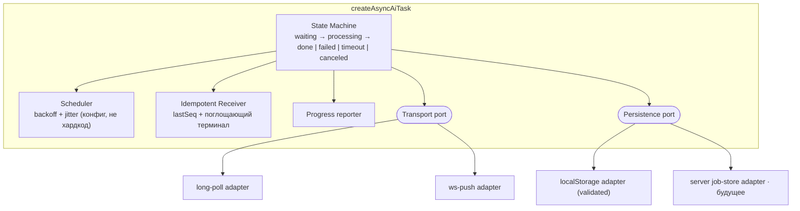

# C4 · Уровень 3 — Components

Внутреннее устройство ядра `createAsyncAiTask` (целевая архитектура). Порты
(`Transport` / `Persistence`) отделяют доменную политику от инфраструктуры.
Ключевое отличие от текущего: **timeout** — явное терминальное состояние, а не
молчаливый дроп задачи через 7 минут.

Трассируемость: `Transport port` — [ADR-0002](../adr/0002-transport-port.md);
`Persistence port` — [ADR-0003](../adr/0003-task-state-store.md);
`Idempotent Receiver` — [ADR-0001](../adr/0001-delivery-guarantees.md), [ADR-0008](../adr/0008-idempotency.md).
