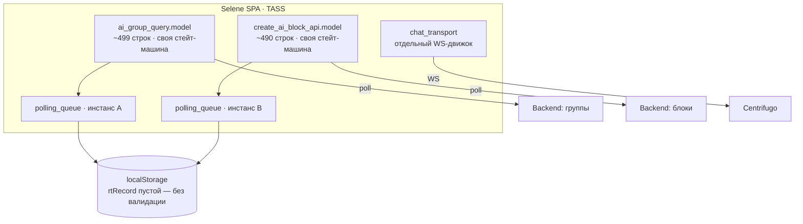
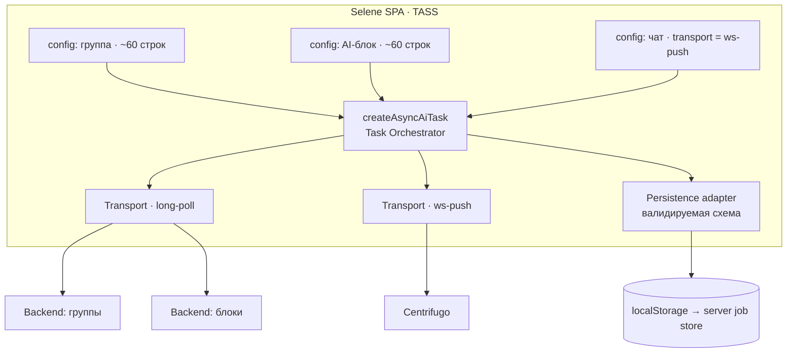

# C4 · Уровень 2 — Containers

## Как сейчас

Два консьюмера по ~490 строк дублируют одну стейт-машину; два независимых инстанса
очереди пишут в один localStorage без валидации; чат — четвёртый, отдельный движок.

## Целевая

Каждый тип задачи — тонкий конфиг (~60 строк). Стейт-машина, планировщик и
персистентность — в ядре `createAsyncAiTask`. Транспорт (long-poll / ws-push) —
сменный адаптер, поэтому чат встаёт в ту же job-модель.

